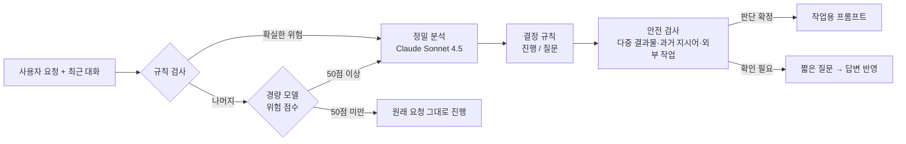
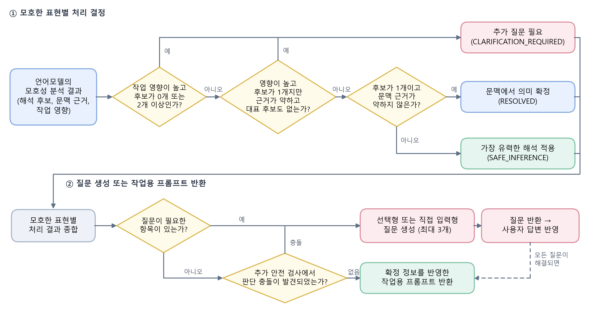
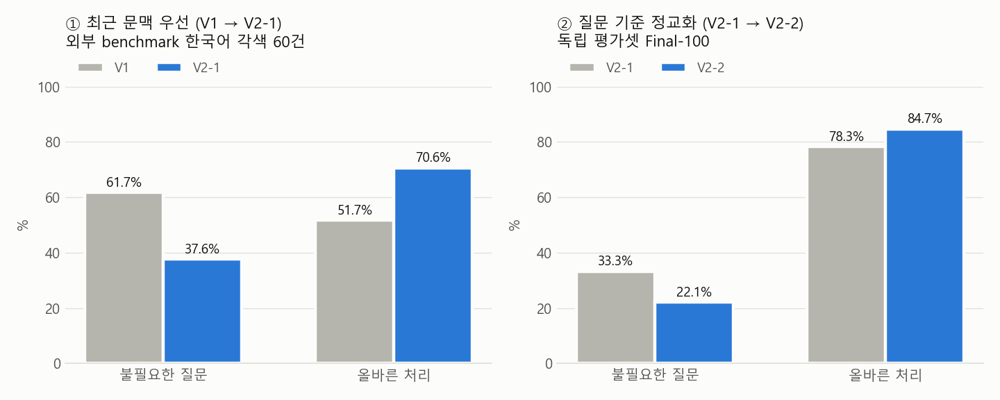

# korean-prompt-improver

한국어의 짧고 모호한 요청을 작업 전에 분석하여, 문맥으로 해소할 수 있는 내용은 그대로 진행하고 확인이 필요한 내용만 사용자에게 질문하는 **MCP 서버**입니다.

---

## 개발 배경

언어모델을 사용할 때 "이거 정리해 줘", "아까 그거 좀 더 공식적인 말투로 바꿔 줘"와 같은 짧은 요청이 자주 사용됩니다. 사람은 앞선 대화를 바탕으로 지시 대상을 자연스럽게 파악하지만, 언어모델은 지시 대상이나 작업 범위를 사용자의 의도와 다르게 판단할 수 있습니다.

반면 모호한 표현마다 질문하면 사용자의 부담이 커집니다. 본 프로젝트는 다음 문제를 중심으로 설계와 평가를 진행하였습니다.

> **요청을 그대로 진행해도 되는 경우와 사용자에게 확인해야 하는 경우를 어떻게 구분할 것인가**

## 시스템 구조 (최종 V3)



- **분석과 결정의 분리**: 언어모델은 해석 후보, 문맥 근거, 작업 영향만 분석하고, 질문 여부는 같은 입력에 항상 같은 결과를 내는 결정 규칙이 정합니다.
- **선택적 분석**: 규칙과 경량 모델(Claude Haiku 5.5)로 위험도를 먼저 판단하여, 위험한 요청에만 정밀 분석을 수행합니다.
- **규칙 기반 안전 검사**: "아까 그거"처럼 가리킬 수 있는 결과물이 여럿인데 하나로 확정한 경우, 언어모델과 독립된 규칙이 이를 질문으로 전환합니다.

<details>
<summary>결정 규칙 흐름도</summary>
<p align="center"></p>
</details>

## 아이디어 변경 과정

| 단계 | 발견한 문제 | 적용한 방법 | 결과 |
|---|---|---|---|
| **V1 초기 구축** | 한국어 모호성의 분류와 처리 기준 정립 | 다섯 가지 모호성 유형, 결정 규칙, MCP 연동 | Claude Desktop에서 분석 → 질문 → 답변 반영 → 프롬프트 생성 과정 확인. 실제 모델 평가에서 문맥으로 해소 가능한 요청에도 15건 질문 |
| **V2-1 최근 문맥** | 최근 대화와 오래된 대화를 같은 비중으로 판단, 긴 문서 뒷부분 미반영 | 최근 대상 우선 규칙, 문서 입력 4,000 → 12,000자 | 불필요한 질문 **61.7% → 37.6%**, 올바른 처리 **51.7% → 70.6%** |
| **V2-2 질문 기준** | 해석이 여러 개 가능한 경우를 모두 질문 대상으로 판단 | 핵심 정보만 질문하고 주변 정보는 빈칸으로 처리, 분석 호출 통합 | 불필요한 질문 **33.3% → 22.1%** |
| **V3 안정화** | 과거 지시 표현의 대상을 잘못 확정, 모든 요청에 정밀 분석 수행 | 규칙 기반 안전 검사, 선택적 분석, 질문 문구 개선 | 기존 실패 사례 3/3 교정, 40건 중 19건 분석 생략, 질문 길이 중앙값 **103자 → 59자** |

<p align="center"></p>

단계별 설계 변경의 배경은 [ideas/](ideas/README.md)에 정리하였습니다.

## 평가 방법과 결과

최종 평가에서는 MCP를 사용하지 않는 조건과 함께, 개발 과정에서 정리한 판단 기준을 프롬프트 지침 4줄로만 제공한 조건을 비교 대상으로 포함하였습니다.

| 비교 조건 | 내용 |
|---|---|
| Direct | MCP 없이 언어모델이 요청을 직접 처리 |
| Direct+지침 | MCP 없이 판단 기준을 4줄의 지침으로 제공 |
| MCP V3 | 개발한 MCP의 분석 결과를 언어모델이 활용 |

- **Final-120**: 사용자에게 전달되는 최종 응답 평가 (120건, 사람 검수 반영)
- **Decision-150**: 작업 수행을 제외하고 진행/질문 판단만 평가 (150건)

| | Direct | Direct+지침 | MCP V3 |
|---|---|---|---|
| Final-120 모호성 처리 점수 | 0.800 | 0.904 | 0.900 |
| Decision-150 판단 정확도 | 80.0% | 80.7% | 86.0% |

- MCP V3는 두 평가 모두에서 Direct보다 높은 점수를 기록하였으며, 특히 문맥으로 대상을 확인할 수 있는 요청을 추가 질문 없이 처리하였습니다.
- 지침 4줄 조건도 유사한 성능을 보였습니다. 이는 개발 과정에서 정립한 **판단 기준 자체가 성능의 핵심**임을 보여줍니다.

데이터셋별 결과와 차트는 [results/](results/README.md)에 정리하였습니다.

## 저장소 구조

```
├─ src/                    분석 엔진
│  ├─ workflow.ts            분석 → 결정 → 질문/프롬프트 생성 흐름, 답변 반영
│  ├─ ambiguityAnalyzer.ts   언어모델 모호성 분석
│  ├─ decisionEngine.ts      진행/질문 결정 규칙
│  ├─ clarificationQuestionGenerator.ts · contextResolver.ts · types.ts
│  ├─ llm/                   언어모델 API 연결
│  └─ promptBuilder/         작업용 프롬프트 생성
├─ experimental/v3/        ★ 최종 V3 MCP 서버
│  ├─ server.ts              MCP 진입점 (analyze_prompt 도구)
│  ├─ selectiveWorkflow.ts   선택적 분석 흐름
│  ├─ riskRouter*.ts · lightRouter.ts · hybridRouter.ts   위험도 판단
│  ├─ guards.ts              규칙 기반 안전 검사
│  ├─ questionFormat.ts · toolDescription.ts   질문 문구와 도구 설명
│  └─ directGuidance.ts      판단 기준을 정리한 지침 4줄
├─ test/                   핵심 단위 테스트 (Vitest)
├─ results/                평가 결과 요약과 차트
├─ docs/                   최종보고서
├─ ideas/                  문제 정의와 설계 변경 기록
└─ assets/                 그림
```

`experimental/v3/`는 개발 당시의 폴더 구조를 그대로 유지한 것으로, 최종 V3 MCP 서버의 코드입니다.

## 실행 방법

```bash
npm install
npm test
```

API 호출 없이 결정 규칙, 분석 흐름, 문맥 처리, 프롬프트 생성에 대한 핵심 단위 테스트 63개가 실행됩니다.

**MCP 서버 실행 (V3)**: `.env`에 `ANTHROPIC_API_KEY`를 설정한 뒤 실행합니다.

```bash
KPI_PIPELINE=v3 KPI_ROUTER_VERSION=0.2 KPI_ROUTER=hybrid KPI_LIGHT_MODEL=claude-haiku-5-5 npx tsx experimental/v3/server.ts
```

### Claude Desktop 연결

Claude Desktop 설정의 개발자 메뉴에서 `claude_desktop_config.json`을 열고 아래 항목을 추가한 뒤, Desktop을 완전히 종료하고 다시 실행합니다. 경로는 저장소를 내려받은 위치로, API 키는 본인의 키로 바꿉니다.

```json
{
  "mcpServers": {
    "korean-prompt-improver-v3": {
      "command": "node",
      "args": [
        "<저장소 경로>/node_modules/tsx/dist/cli.mjs",
        "<저장소 경로>/experimental/v3/server.ts"
      ],
      "env": {
        "ANTHROPIC_API_KEY": "<본인의 Anthropic API 키>",
        "KPI_PIPELINE": "v3",
        "KPI_ROUTER_VERSION": "0.2",
        "KPI_ROUTER": "hybrid",
        "KPI_LIGHT_MODEL": "claude-haiku-5-5"
      }
    }
  }
}
```

- 이 서버는 로컬(stdio) 서버이므로, URL을 입력하는 커넥터 추가 화면이 아니라 설정 파일로 등록합니다.
- 분석에 사용되는 API 비용은 입력한 Anthropic API 키로 청구되며, Claude 구독과는 별개입니다.

### 실제 사용 예시

Claude Desktop 채팅에서 연결을 확인한 결과입니다. 도구 사용 여부는 Claude가 판단하므로, 확실하게 사용하려면 요청에 도구 사용을 명시합니다.

> **사용자**: korean-prompt-improver-v3의 analyze_prompt 도구로 먼저 분석한 뒤 처리해 줘.
> (발표 대본 → 예상 질문 → 발표 제목 후보를 차례로 작성한 상황에서) 아까 그거 좀 더 공식적인 말투로 바꿔줘.
>
> **Claude** (analyze_prompt 사용): "아까 그거"은(는) 다음 중 무엇을 의미하나요?
> 1. 발표 제목 후보 2. 예상 질문 3. 발표 대본
>
> **사용자**: 발표 대본
>
> **Claude** (analyze_prompt 사용): 분석을 마쳤습니다. 바꿀 대상은 발표 대본으로 정해졌습니다.

MCP를 사용하지 않은 경우에는 두 가지 해석을 문장으로 설명하는 긴 답변이 생성되었으나, MCP를 사용한 경우에는 선택형 질문 하나로 대상을 확인하고 답변을 반영해 작업 대상을 확정하였습니다.

## 관련 문서

- [results/](results/README.md) — 데이터셋 구성과 성능 차트
- [ideas/](ideas/README.md) — 문제 정의와 설계 변경 배경
- [docs/](docs/README.md) — 최종보고서

## 사용 기술

TypeScript · Node.js · MCP SDK · Zod · Vitest · Anthropic API (Claude Sonnet 4.5, Claude Haiku 5.5)

V2-1 평가에는 공개 benchmark인 CLAMBER와 MuDoCo(CC BY-NC 4.0)를 바탕으로 한국어 작업 상황에 맞게 각색한 사례를 사용하였습니다.
