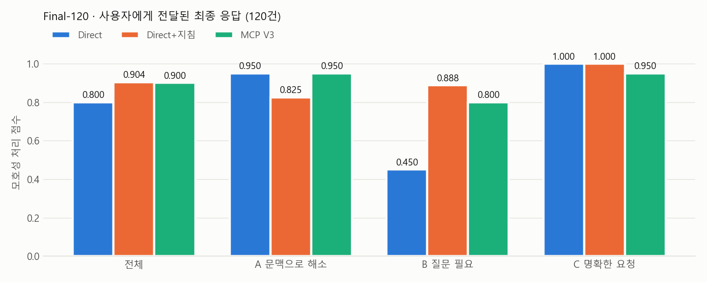
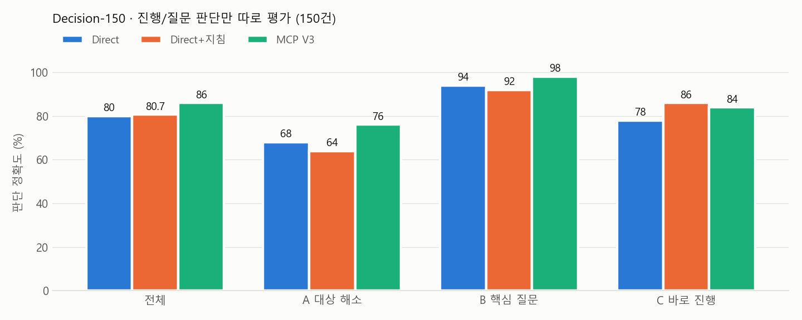

# 평가 결과

개발 과정에서 네 차례의 평가를 수행하였습니다. 앞의 두 평가는 **버전별 개선 효과**를, 뒤의 두 평가는 **최종 V3와 비교 조건 간의 성능**을 확인하기 위한 것입니다.

| 평가 | 규모 | 평가 목적 | 비교 |
|---|---|---|---|
| 외부 benchmark 각색 | 60건 × 3회 | 최근 문맥 우선 규칙의 효과 | V1 → V2-1 |
| Final-100 | 100건 × 3회 | 질문 기준 개선의 효과 | V2-1 → V2-2 |
| **Final-120** | 120건 | 사용자에게 전달되는 최종 응답 | Direct / Direct+지침 / MCP V3 |
| **Decision-150** | 150건 | 진행/질문 판단 | Direct / Direct+지침 / MCP V3 |

평가 사례는 다음 세 유형으로 구분하였습니다.

- **A 유형**: 요청은 모호하지만 이전 대화로 대상을 확인할 수 있는 경우 → 질문 없이 진행하면 정답
- **B 유형**: 문맥으로도 확인할 수 없어 질문이 필요한 경우 → 핵심 내용을 질문하면 정답
- **C 유형**: 이미 명확하거나 일반적인 답변이 가능한 요청 → 질문 없이 진행하면 정답

---

## 1. 버전별 개선

<p align="center"></p>

- **V1 → V2-1**: 최근 대화의 대상을 우선하도록 수정한 결과, 불필요한 질문은 61.7%에서 37.6%로 감소하고 올바른 처리는 51.7%에서 70.6%로 증가하였습니다.
- **V2-1 → V2-2**: 해석이 여러 개 가능한 경우와 질문이 필요한 경우를 구분한 결과, 불필요한 질문이 33.3%에서 22.1%로 감소하였습니다. 이 평가셋은 이전 개발 과정에서 사용하지 않은 사례로 새로 구성하였습니다.

## 2. Final-120 — 최종 응답 평가

<p align="center"></p>

- 점수는 성공 1점, 부분 정답(핵심은 질문했으나 후보 일부를 누락) 0.5점, 실패 0점으로 산정하였습니다.
- **MCP V3**는 A 유형에서 대상을 확인하고 바로 진행하였으며(0.950), 질문이 간결하였습니다(질문 응답 길이 중앙값 60자, Direct+지침 97자, Direct 415자).
- **Direct**는 질문이 필요한 상황에서 후보를 모두 처리하는 경우가 많아 B 유형 점수가 낮았습니다(0.450).
- **Direct+지침**은 B 유형에서 후보를 빠짐없이 질문하였으나, A 유형에서는 이미 확인된 대상을 다시 확인하는 경우가 있었습니다(0.825).

## 3. Decision-150 — 판단 평가

<p align="center"></p>

- Final-120의 최종 응답에는 문장 생성 능력, 도구 호출 여부 등 판단 이외의 요인이 함께 반영됩니다. 이에 응답 생성을 제외하고 **"진행 / 질문, 대상, 질문 내용"만 제출**받아 채점하는 평가를 별도로 설계하였습니다.
- **MCP V3**는 전체(86.0%), A 유형 대상 해소(76%), B 유형 핵심 질문(98%)에서 가장 높은 정확도를 기록하였습니다.
- MCP가 정밀 분석을 수행한 65건에서는 90.8%의 정확도를 보였습니다.

## 4. 검증 방법

- **평가 방법 사전 고정**: 사례, 채점 기준, 비교 방법을 실행 전에 문서로 등록하고, 이후 변경 여부를 파일 지문으로 확인하였습니다(상세 내용은 [최종보고서](../docs/README.md) 참고).
- **조건을 가린 사람 검수**: Final-120에서는 응답의 조건을 숨긴 168행을 사람이 검수하였습니다.
- **통계 검정**: MCP V3는 Direct보다 수치상 높았으나 사전에 정한 기준에서 통계적으로 유의하지 않았으며, Direct+지침과는 비열등한 수준으로 나타났습니다.

## 데이터 구성 예시

아래는 Final-120과 Decision-150의 사례 예시입니다. 각 사례는 요청, 앞선 대화, 정답 판단과 그 근거로 구성됩니다.

**Final-120 · B 유형**

```json
{
  "id": "F-B19",
  "type": "B",
  "input": {
    "current_user_request": "아까 그 파일 팀 드라이브에서 지워줘.",
    "recent_conversation": [
      "User: 동아리_회계보고_초안.xlsx 올렸어.",
      "User: 수정본도 올렸어. 동아리_회계보고_수정.xlsx",
      "User: 이게 진짜 최종이야. 동아리_회계보고_최종.xlsx"
    ]
  },
  "gold": {
    "expected_behavior": "CLARIFY",
    "clarify_candidates": ["동아리_회계보고_초안.xlsx", "동아리_회계보고_수정.xlsx", "둘 다"],
    "rationale": "'아까 그 파일'이 초안·수정본 중 무엇인지 알 수 없고, 삭제는 되돌리기 어렵다"
  }
}
```

**Decision-150 · A 유형**

```json
{
  "id": "D-A01",
  "type": "A",
  "input": {
    "current_user_request": "그 사람한테 보낼 감사 문자 써줘.",
    "recent_conversation": [
      "User: 이번 이사 때 도와준 사람이 둘이야. 민재는 짐만 옮겨 줬고, 수현이는 트럭까지 빌려 와서 하루 종일 같이 있었어. 수현이한테는 따로 꼭 고맙다고 하고 싶어."
    ]
  },
  "gold": { "decision": "PROCEED", "target": "수현" }
}
```

(예시는 가독성을 위해 일부 필드와 대화 내용을 생략하였습니다.)

## 폴더 구성

| 경로 | 내용 |
|---|---|
| `charts/` | 성능 차트 3종과 생성 스크립트 `make_charts.py` |
